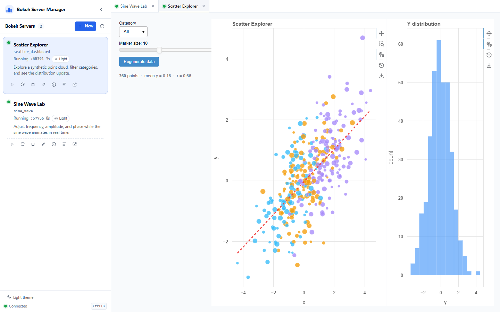

**English** | [简体中文](README.zh-CN.md) | [日本語](README.ja.md)

# Bokeh Server Manager



A local web interface for running and managing several Bokeh server applications from one place.

Each application runs in its own Bokeh process. The manager assigns a free port on every start, embeds the running app in an iframe tab, and provides a source editor in a separate window.

## Features

- Multilingual interface: English, Simplified Chinese, and Japanese.
- Collapsible, resizable sidebar. Toggle it with `Ctrl+B` (or `Cmd+B`).
- One process per Bokeh server, with an automatically assigned port.
- Multiple running servers displayed as tabs; each tab is an iframe.
- Start, reload, stop, edit source, edit metadata, view logs, and open a server in a new window.
- Create a new Bokeh server from a blank or interactive template.
- Light / dark themes for the manager, the editor, and Bokeh pages.
- Source editor with a file tree, syntax highlighting, and `Ctrl+S` saving.
- Bokeh `--dev` live reloading. The manager refreshes the iframe when the Bokeh process restarts.
- Per-server metadata: title, description, and usage notes.
- Two ready-to-run examples.

## Languages

Use the language selector in the sidebar footer to switch the interface between English, Simplified Chinese, and Japanese.

- The default language follows the browser language (`zh*` uses Simplified Chinese, `ja*` uses Japanese, everything else uses English).
- The selection is saved in the browser and survives reloads.
- The manager and any open editor window update immediately. Open files and unsaved changes are preserved.
- Bokeh application content inside the iframe is not translated.
- `server.json` metadata is displayed as entered and is not translated.

## Requirements

- Windows with the project environment at `C:\pixi_env\.pixi\envs\default\python.exe`
- Python 3.14
- Dependencies listed in `requirements.txt`:
  - `bokeh>=3.9,<4`
  - `flask>=3.1,<4`
  - `psutil>=7,<8`
  - `PyYAML>=6,<7`

The Bokeh process needs `MKL_THREADING_LAYER=TBB` with this environment. `start.bat` sets it automatically.

## Quick start

Double-click `start.bat`.

The manager starts at <http://127.0.0.1:8010> and opens the browser automatically.

To run it manually:

```bat
set MKL_THREADING_LAYER=TBB
C:\pixi_env\.pixi\envs\default\python.exe -u app.py
```

Set `BSM_PORT` to use a different manager port.

## Server directory convention

Every application lives in its own subdirectory:

```text
servers/
  my_app/
    main.py          # required Bokeh directory application entry point
    server.json      # optional title / description / usage metadata
    other files...   # data, modules, assets, etc.
```

The manager discovers directories under `servers/` automatically. A directory without `main.py` is listed but cannot be started.

The following files are generated by the manager when a server starts and are ignored by Git:

- `theme.yaml` - Bokeh model theme for the selected light/dark mode.
- `templates/index.html` - page backdrop that matches the Bokeh theme.

They are rewritten on every start, so edit the manager theme or the app code instead of editing these generated files.

## Metadata

Each server can have a `server.json` file:

```json
{
  "title": "My App",
  "description": "A short summary shown in the sidebar.",
  "usage": "How to use this app. Line breaks are preserved."
}
```

- `title` is used in the sidebar and tab titles. It falls back to the directory name.
- `description` is shown under the server title.
- `usage` is shown in the **Server information** dialog.
- Metadata is not translated; it is displayed exactly as entered.
- Unknown JSON keys are preserved.
- Use the info button on a server card to edit these fields without touching JSON.
- A malformed `server.json` is reported in the UI but does not prevent the server from starting.

## Theme behavior

- The manager and editor switch between light and dark immediately.
- A Bokeh server keeps the theme it was started with. Running servers do not change theme in place.
- Starting or reloading a server writes the current manager theme into `theme.yaml` and the page template.
- To apply a new theme to a running server, click **Reload**.
- The server card shows the theme that the running process is using.

## Live reload

Servers are started with:

```text
python -m bokeh serve --dev ...
```

Bokeh watches the application directory. After a source file is saved:

1. Bokeh restarts the server process.
2. The manager detects the new process ID on its next status poll.
3. The open iframe is refreshed so BokehJS reconnects cleanly.

This avoids stale BokehJS model references that can appear when only the websocket reconnects.

## Source editor

Click the pencil button on a server card to open the editor in a separate window.

- Left side: complete file tree for that server directory.
- Right side: CodeMirror editor with Python, HTML, CSS, JavaScript, JSON, YAML, and Markdown modes.
- `Ctrl+S` saves the current file.
- Unsaved changes are marked and prompt before switching files or closing the window.
- `theme.yaml` and `templates/index.html` are marked `AUTO`; `server.json` is marked `META`.
- The editor follows the manager's light/dark theme and language.

## Creating a server

Click **New** in the sidebar.

- Directory names may contain letters, numbers, underscores, and hyphens.
- Choose **Blank** for a minimal Bokeh page, or **Interactive** for a sine-wave plot with a slider and a server-side callback.
- The title defaults to the directory name and can be changed later in the **Server information** dialog.
- New servers are stopped by default unless **Start immediately** is checked.

## Examples

Two examples are included:

- **Sine Wave Lab** (`servers/sine_wave`) - animated sine wave with waveform, frequency, amplitude, speed, and phase controls.
- **Scatter Explorer** (`servers/scatter_dashboard`) - synthetic scatter plot with category filtering, marker sizing, a regression line, and a linked Y histogram.

Start them from the sidebar to verify the full workflow, including theme switching, language switching, and `--dev` reloading.

## API

The manager exposes a small local JSON API:

```text
GET    /api/servers
POST   /api/servers
GET    /api/servers/<name>
POST   /api/servers/<name>/start
POST   /api/servers/<name>/stop
POST   /api/servers/<name>/reload
GET    /api/servers/<name>/logs
GET    /api/servers/<name>/tree
GET    /api/servers/<name>/file?path=...
PUT    /api/servers/<name>/file
PUT    /api/servers/<name>/metadata
```

Start, stop, reload, and metadata requests take JSON bodies. File paths are restricted to the selected server directory. Send `X-BSM-Lang: en | zh-CN | ja` to localize manager error messages.

## Notes

- The manager binds only to `127.0.0.1`. It has no authentication; do not expose it to an untrusted network.
- The manager is a local development tool, not a production deployment server.
- `start.bat` hard-codes the Python path `C:\pixi_env\.pixi\envs\default\python.exe`. Change `PYTHON` in the file if your environment is elsewhere.
- Generated per-server theme files are ignored by Git. They are recreated on demand.
